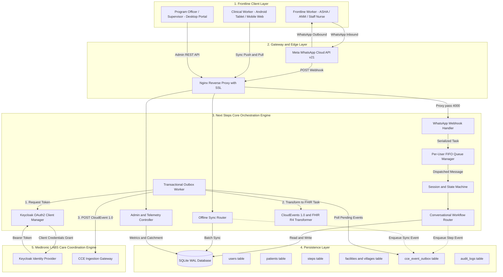
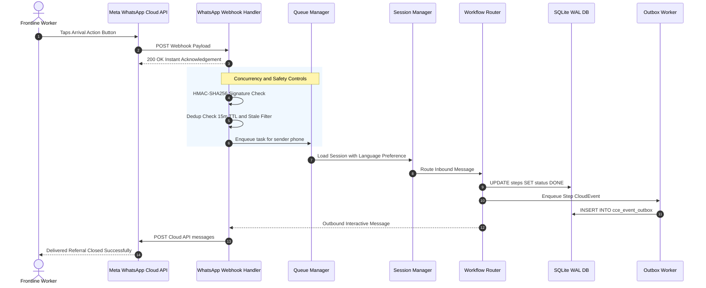
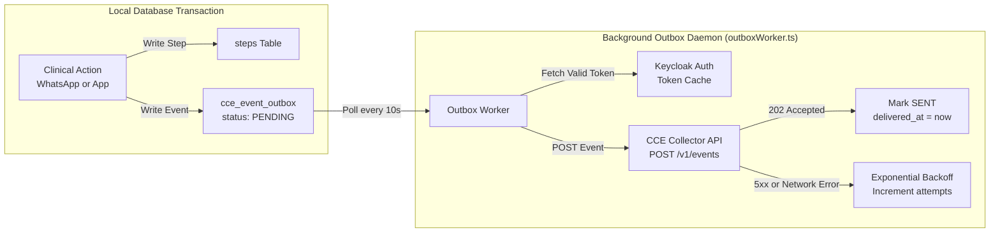

# Next Steps: End-to-End System Architecture

This document provides a comprehensive technical architecture specification for the **Next Steps Care Coordination Platform**. It details how the **WhatsApp Bot**, the **Frontline Mobile App**, the **Supervisory Admin Panel**, the **Node.js Backend**, the **SQLite Database**, and the **Medtronic LABS Care Coordination Engine (CCE)** interconnect to deliver closed-loop frontline health coordination.

---

## 1. High-Level Architecture & Connectivity

The Next Steps platform bridges the last-mile gap between community frontline workers (ASHAs, ANMs) and referral facilities (PHCs, CHCs, District Hospitals) through two synchronized client experiences backed by a single centralized orchestration engine.



---

## 2. Technology Stack Breakdown

| Tier | Component | Technology / Library | Purpose & Responsibilities |
| :--- | :--- | :--- | :--- |
| **Frontline Bot** | Messaging Gateway | **Meta WhatsApp Cloud API (Graph API v21)** | Delivers zero-install clinical workflows to frontline health workers via interactive buttons, lists, and WhatsApp Flows. |
| **Frontline App** | Mobile Web & PWA | **React 18, TypeScript, Vite, Tailwind CSS** | Responsive 4-tab interface (`Lookup`, `Worklist`, `Alerts`, `Insights`) with integrated AI RAG Copilot and offline storage. |
| **Android Client** | Native Wrapper | **Android SDK / WebView APK** | Standalone APK (`NextSteps-MaternalCare.apk`) installable on government-issued frontline Android tablets/phones. |
| **Admin Portal** | Desktop Portal | **React 18, TypeScript, Vite, Lucide Icons** | District dashboard for catchment hierarchy management, user assignment, telemetry inspection, and care cascade analytics. |
| **Backend Core** | Runtime & Framework | **Node.js 20 LTS, Express 4, TypeScript** | REST API engine, WhatsApp webhook router, state machine manager, and CCE outbox worker. |
| **Database** | Primary Store | **SQLite 3 (`better-sqlite3` + `node:sqlite` fallback)** | Zero-maintenance embedded relational database running in **WAL mode** (`PRAGMA journal_mode = WAL;`) for high concurrent I/O. |
| **Authentication** | Enterprise Auth | **Keycloak OAuth2 / OpenID Connect** | Client Credentials Grant (`nextstep-emitter`) for server-to-server authorization with the Medtronic LABS CCE ecosystem. |
| **Standards** | Interoperability | **CloudEvents v1.0 & HL7 FHIR R4 `Task`** | Canonical event envelopes wrapping clinical healthcare task definitions for regional aggregation. |
| **Infrastructure** | Hosting & Proxy | **AWS EC2 (Ubuntu 22.04 LTS), Nginx, PM2** | Production hosting (`13.232.251.63`) with automated SSL certificates, reverse proxy routing, and auto-restarting PM2 daemons. |

---

## 3. Component Architecture & Interconnections

### 3.1 WhatsApp Bot Engine (`backend/src/whatsapp/`)

The WhatsApp Bot provides an interactive conversational interface that translates clinical workflows into WhatsApp Interactive Messages (Buttons and Lists).



#### Core Components & Reliability Features:
1. **Instant Webhook Acknowledgments**:
   - The webhook endpoint immediately responds to Meta with `res.sendStatus(200)` before running business logic, preventing Meta retry loops and backpressure.
2. **Per-User Sequential Queue (`enqueueUserTask`)**:
   - Each sender's phone number has an isolated `Promise` chain stored in a `userQueues` Map.
   - **Concurrency**: 100 different workers sending messages at the exact same instant execute concurrently on separate event-loop microtasks without blocking each other.
   - **FIFO Safety**: Rapid double-tapping from the same user is serialized strictly in order, preventing race conditions on session states.
3. **Deduplication & Staleness Filter (`isDuplicateOrStale`)**:
   - Tracks processed Meta message IDs in a 15-minute TTL memory cache (`processedMessageIds`).
   - Discards stale webhook deliveries older than 300 seconds.
4. **Dynamic Bilingual Engine & Persistent Preferences**:
   - Users can toggle between **English** and **conversational Hindi** at any time by tapping `🌐 भाषा / English` or typing `language` / `भाषा`.
   - The preference is stored directly in `users.preferred_lang` in SQLite and preserved in `ConversationSession.lang`.
5. **Meta 20-Character Button Title Constraint**:
   - Interactive button titles are strictly constrained to $\le 20$ characters (e.g., `'उपस्थिति दर्ज'`, `'वापस सूची'`) to guarantee that the Meta Graph API never rejects outbound messages with HTTP 400.

---

### 3.2 Frontline Mobile Web & Android App (`/mobile-app`)

The Frontline Mobile App is designed for offline-first clinical field operations:

- **4-Tab Clinical Interface**:
  - `Lookup`: Instant patient search by Name, Phone, or ABHA/RCH ID, with instant deep-linking.
  - `Worklist`: Categorized triage cards (Overdue, Due Today, Upcoming) with single-tap status actions.
  - `Alerts`: Real-time escalation of high-risk pregnancies (HRP) and overdue facility visits.
  - `Insights & Copilot`: Visual care cascade funnels and a role-specific AI Copilot.
- **Bilingual Interface**: Seamless `English | हिंदी` header toggle with full dictionary localization.
- **Offline Synchronization Architecture**:
  - When offline, patient edits and step completions are recorded in a local IndexedDB / memory transaction log.
  - Upon network reconnection:
    - **Push Sync (`POST /api/sync/push`)**: Replays offline mutations to the backend. The backend updates SQLite and automatically enqueues corresponding CloudEvents into the CCE Outbox.
    - **Pull Sync (`GET /api/sync/pull`)**: Hydrates the client with the latest server state, catchment changes, and facility updates.

---

### 3.3 Database Architecture (`data/nextsteps.db`)

The backend uses an embedded SQLite database configured for high-concurrency production workloads:

```sql
PRAGMA journal_mode = WAL;
PRAGMA synchronous = NORMAL;
```

#### Core Database Schema:
```
+-------------------------------------------------------------------------------------------------+
|                                     SQLITE DATABASE SCHEMA                                      |
+-------------------------------------------------------------------------------------------------+

  [facilities]                    [users]                        [patients]
  - id (PK)                       - id (PK)                      - id (PK)
  - name                          - name                         - name / name_hi
  - level (SUBCENTRE/PHC/CHC/DH)  - phone (UNIQUE)               - phone
  - block / district              - role (anm/phc_sn/chc_sn/...) - service (ANC/PNC/NCD)
  - services                      - facility_id (FK)             - village_id / village_name
                                  - preferred_lang (hi / en)     - subcentre_id
                                  - is_active                    - asha_name
                                                                 - status (HRP / NORMAL)
                                                                 - age / lmp / edd / abha_id

  [steps]                         [cce_event_outbox]             [audit_logs]
  - id (PK)                       - id (PK)                      - id (PK)
  - patient_id (FK)               - event_id (UNIQUE)            - user_id / user_name
  - cat (ANC_VISIT/LAB/REFERRAL)  - cloud_events_id              - action (SYNC_PUSH/...)
  - level (SUBCENTRE/PHC/CHC/DH)  - event_type                   - details
  - due / sent_at                 - subject (Patient/...)        - timestamp
  - status (OPEN/DONE/CANCELLED)  - facility_id
  - owner_role                    - payload (JSON CloudEvent)
  - closed_at / closed_by         - status (PENDING/SENT/FAILED)
  - closed_source (AT_FACILITY)   - attempts / last_error
  - closed_level                  - created_at / delivered_at
```

---

### 3.4 Medtronic LABS Care Coordination Engine (CCE) Integration

The backend implements the **Transactional Outbox Pattern** to ensure zero data loss when publishing events to the Medtronic LABS OpenPHC infrastructure:



#### 1. OAuth2 Authentication Flow (`cceAuth.ts`)
- Target: `https://keycloak.cce.mdtlabs.org/realms/cce/protocol/openid-connect/token`
- Protocol: `client_credentials` grant with Client ID `nextstep-emitter`.
- Token Caching: Tokens are cached in-memory with automatic proactive refresh whenever less than 60 seconds remain before expiry.

#### 2. Canonical CloudEvents 1.0 Envelope (`cceTransformer.ts`)
Each care step mutation is converted into a standard CloudEvents 1.0 envelope containing a FHIR R4 `Task`:

```json
{
  "specversion": "1.0",
  "id": "evt-step-2-mue7ezq0",
  "source": "org.openphc.nextsteps.subcentre",
  "type": "org.openphc.task.updated",
  "subject": "Patient/w1",
  "time": "2026-09-29T18:00:00.000Z",
  "datacontenttype": "application/json",
  "facilityid": "FAC-SC-GHU",
  "correlationid": "corr-8f192b0c",
  "data": {
    "resourceType": "Task",
    "id": "task-step-2",
    "status": "completed",
    "intent": "order",
    "code": {
      "coding": [
        {
          "system": "http://openphc.org/codes/step-category",
          "code": "ANC_VISIT",
          "display": "ANC Routine Checkup"
        }
      ]
    },
    "for": {
      "reference": "Patient/w1",
      "display": "Sunita Devi"
    },
    "executionPeriod": {
      "end": "2026-09-29T18:00:00.000Z"
    }
  }
}
```

#### 3. Guaranteed Delivery (`outboxWorker.ts`)
- A background worker polls the `cce_event_outbox` table every 10 seconds.
- Successfully ingested events (`HTTP 200` or `HTTP 202 Accepted`) are marked `SENT` with a timestamp.
- Transient network failures trigger exponential backoff with jitter up to 5 attempts before marking `FAILED`, which can be manually re-triggered from the Admin Panel.

---

## 4. End-to-End Clinical Lifecycle Walkthrough

To see how all pieces operate together in practice, consider a patient referral workflow:

```
[1. Village Level]
  • ASHA identifies high-risk pregnant mother (Sunita Devi) with severe anemia in Village Ghurehta.
  • ANM Rekha opens WhatsApp or the Next Steps Mobile App on her phone.
  • ANM prescribes an Urgent Ultrasound (USG) Referral to CHC Teonthar.
  • Local DB creates step Record: (cat='REFERRAL', level='CHC', status='OPEN').
  • Outbox Worker immediately generates CloudEvent: (type='org.openphc.task.created') 
    and dispatches it securely to the live CCE Collector via Keycloak Bearer token.

[2. Facility Level]
  • Staff Nurse Priya at CHC Teonthar opens her WhatsApp Bot and taps 'Expected Arrivals'.
  • The bot queries SQLite for open referrals where level = 'CHC'.
  • Priya sees Sunita Devi arriving from Sub-centre Ghurehta.
  • When Sunita arrives at the CHC OPD, Priya taps 'उपस्थिति दर्ज' (Confirm Arrival).
  • Step status updates to AT_FACILITY.

[3. Care Completion & Loop Closure]
  • After the obstetrician completes the ultrasound scan, Priya taps 'सेवा पूरी हुई' (Care Delivered).
  • Step is marked status='DONE' with full provenance (closed_source='AT_FACILITY', closed_by='Priya').
  • Outbox Worker publishes (type='org.openphc.task.updated', status='completed') to the CCE Gateway.
  • ANM Rekha's Worklist at Sub-centre Ghurehta updates automatically, showing the referral completed.
```

---

## 5. Security, Privacy & Compliance Architecture

1. **Unregistered Sender Isolation**:
   - Inbound WhatsApp messages from phone numbers not linked in `users` receive a generic denial message without leaking any patient records, catchment details, or system metadata.
2. **Zero-PII Outbox Payloads**:
   - CloudEvents transmitted over the WAN contain healthcare task references, category codes, and anonymized patient identifiers (`Patient/w1`), keeping sensitive identification on-premise.
3. **Cryptographic Webhook Verification**:
   - Meta webhooks are cryptographically authenticated using SHA-256 HMAC digest validation against the shared Meta App Secret (`x-hub-signature-256`).
4. **HTTPS / TLS 1.3 Transport Security**:
   - All external endpoints (Webhooks, Web App, Admin API, Keycloak, CCE Gateway) enforce encrypted TLS transport with automated Let's Encrypt certificate renewal.
