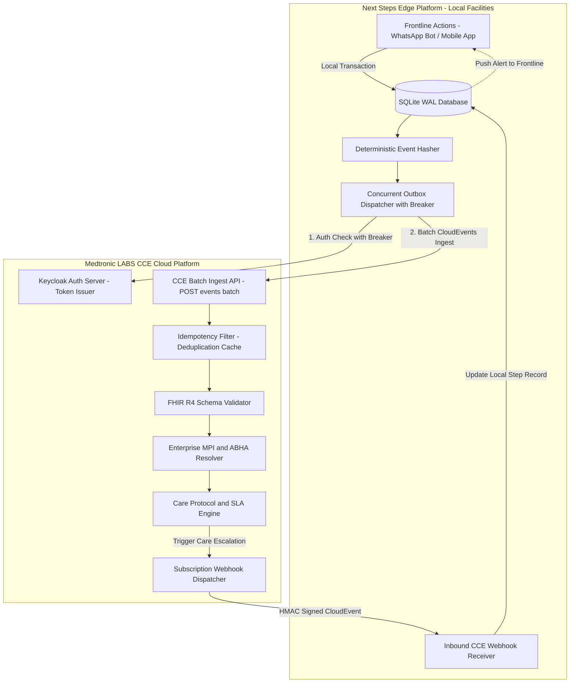

# Senior Architectural Audit: Next Steps ↔ Medtronic LABS CCE Integration

**Author:** Antigravity Senior Systems & Healthcare Architect  
**Scope:** Integration between Next Steps (Frontline Edge Platform & WhatsApp Bot) and the live Medtronic LABS Care Coordination Engine (CCE / OpenPHC)  
**Target Environments:** AWS EC2 Production (`13.232.251.63`), Keycloak (`keycloak.cce.mdtlabs.org`), CCE Collector (`api.cce.mdtlabs.org`)  

---

## 1. Executive Summary

Next Steps has successfully implemented a **resilient, local-first transactional outbox pattern** that decouples frontline clinical interactions (via WhatsApp and the mobile PWA) from cloud connectivity. It wraps clinical actions into **CloudEvents 1.0** containing **HL7 FHIR R4 Task** resources, authenticated against Keycloak with client credentials.

However, an audit of the current live implementation reveals that the integration is currently **unidirectional (push-only)**, exposes **non-deterministic event identification** that undermines upstream idempotency, incurs **high sequential network overhead** during batch syncs, and relies on **ad-hoc FHIR extensions and string-based provenance** rather than formal healthcare specifications.

This report provides a senior-level architectural critique of the existing integration, identifies **7 architectural gaps**, and outlines **concrete improvements for both the CCE platform and the Next Steps edge platform**.

---

## 2. Current State Assessment (Baseline)

### 2.1 What Works Well (Architectural Strengths)

```
[Clinical Action: WhatsApp / PWA / Sync]
                    │
                    ▼
       ┌─────────────────────────┐
       │   Local SQLite (WAL)    │ ◄─── Zero latency for frontline workers
       │  (steps + outbox rows)  │
       └─────────────────────────┘
                    │
       [Decoupled Async Daemon]
                    ▼
       ┌─────────────────────────┐
       │   outboxWorker.ts       │ ◄─── Automatic retry with exponential backoff
       │  (cce_event_outbox)     │
       └─────────────────────────┘
                    │
                    ▼
       ┌─────────────────────────┐
       │  Live CCE Gateway /v1   │
       └─────────────────────────┘
```

1. **Transactional Outbox Pattern**: Clinical mutations in SQLite (`steps`, `patients`) and event queuing in `cce_event_outbox` happen within local transactions. Frontline health workers never wait on CCE cloud latency.
2. **Keycloak Bearer Token Caching**: In `backend/src/cce/cceAuth.ts`, OAuth2 tokens are cached in memory and automatically refreshed when validity drops below 60 seconds, preventing redundant token requests.
3. **Asynchronous Retry Loop**: `backend/src/cce/outboxWorker.ts` implements an automated poller with failure tracking (`attempts`), exponential backoff, and manual dead-letter queue reset via the Admin Panel.
4. **Standard Envelope Foundation**: Events adhere to the CloudEvents 1.0 JSON format with structured metadata (`datacontenttype`, `subject`, `facilityid`, `correlationid`).

---

## 3. Deep-Dive Gap Analysis (7 Core Architectural Vulnerabilities)

### Gap 1: Unidirectional Ingestion (No Bidirectional Loop Closure)
* **Current State**: Next Steps pushes events *to* CCE. However, CCE has no way to push protocol triggers, supervisor escalations, regional lab results, or hospital bed availability back into Next Steps.
* **Architectural Risk**:
  - Closed-loop coordination remains broken at the regional boundary. If a patient visits an external tertiary facility that updates CCE directly, the sub-centre ANM's WhatsApp bot never learns of it unless manual offline re-entry occurs.
  - Next Steps is treated as an *event emitter* rather than a *bidirectional participant*.

### Gap 2: Non-Deterministic Event IDs Break Upstream Idempotency
* **Code Reference**: `backend/src/cce/cceTransformer.ts` (Lines 38-39):
  ```typescript
  const eventId = `evt-${step.id.slice(0, 20)}-${Date.now().toString(36)}`;
  const correlationId = `corr-${uuidv4().slice(0, 16)}`;
  ```
* **Architectural Risk**:
  - `eventId` includes `Date.now().toString(36)`. If an outbox row is re-evaluated, rebuilt, or retried after failure, a **brand new event ID is generated**.
  - Upstream CCE relies on CloudEvents `id` for deduplication. Because the ID changes, CCE cannot recognize that this is a retry of the same state transition, leading to **duplicate event processing and inflated analytics in CCE**.
  - `correlationId` generates a fresh UUID on every step rather than inheriting the longitudinal care-plan ID for that patient's pregnancy or NCD episode.

### Gap 3: Sequential HTTP Fan-Out & Missing Batch Ingestion
* **Code Reference**: `backend/src/cce/outboxWorker.ts` (Lines 88-130):
  ```typescript
  for (const row of rows) {
    const result = await publishEventToCce(payload); // Sequential await per row!
  }
  ```
* **Architectural Risk**:
  - When an ANM returns from a field clinic and syncs 40 offline tasks, the backend performs **40 sequential HTTP requests** over the WAN.
  - At ~300ms round-trip latency to `api.cce.mdtlabs.org`, processing 40 events blocks the outbox loop for **12+ seconds**.
  - CCE does not currently expose a bulk ingestion endpoint (`/v1/events/batch`), causing excessive TCP connection and TLS handshake overhead.

### Gap 4: Semantic FHIR Modeling & Ad-Hoc Extensions
* **Code Reference**: `backend/src/cce/cceTransformer.ts` (Lines 46-84):
  - Next Steps represents all care steps purely as FHIR `Task` resources.
  - Healthcare provenance is compressed into an untyped text string in `Task.note`:
    ```typescript
    note: [{ text: `Closed via ${step.closed_source} at ${step.closed_level} by ${step.closed_by}` }]
    ```
* **Architectural Risk**:
  - In FHIR R4, a `Task` represents the operational workflow (execution status), whereas clinical intent requires a `ServiceRequest` (the doctor/ANM's referral order) and an `Encounter` (the facility visit).
  - Provenance (who delivered care, at what facility tier, with what evidence) cannot be machine-queried in CCE because it is locked inside free-text notes rather than structured FHIR `Provenance` resources.

### Gap 5: Patient Identity Fragmentation (Local ID vs. ABHA / EMPI)
* **Code Reference**: `backend/src/cce/cceTransformer.ts` (Line 41):
  ```typescript
  const upid = patientUpid || `Patient/${step.patient_id}`;
  ```
* **Architectural Risk**:
  - Next Steps passes local database IDs (`Patient/w1`, `Patient/pw_01`).
  - Without federation to national health identifiers (ABHA ID) or an Enterprise Master Patient Index (EMPI) within CCE, CCE cannot correlate a patient registered at Sub-centre Ghurehta with the same patient receiving tertiary care at Medical College Jabalpur.

### Gap 6: Outbox Worker Lock Contention & Horizontal Scaling Limit
* **Code Reference**: `backend/src/cce/outboxWorker.ts` (Lines 76-83):
  ```typescript
  SELECT * FROM cce_event_outbox WHERE status = 'PENDING' ... LIMIT ?
  ```
* **Architectural Risk**:
  - If Next Steps is scaled horizontally across multiple PM2 worker clusters or Docker containers on EC2, all workers will query the same SQLite outbox simultaneously.
  - Lacking an atomic row-level reservation or distributed advisory lock, **multiple instances will process the exact same outbox row**, sending duplicate events to CCE.

### Gap 7: Keycloak Thundering Herd & Missing Circuit Breaker
* **Code Reference**: `backend/src/cce/cceAuth.ts` (Lines 14-58):
  - If Keycloak becomes unavailable, every event in the outbox loop throws an unhandled error and immediately retries on the next tick.
* **Architectural Risk**:
  - No circuit breaker pattern is present. If Keycloak or the CCE Gateway experiences downtime, Next Steps hammers the authentication endpoint with repeated token requests on every 3-second polling interval, exacerbating the outage.

---

## 4. Target Architecture: Next Steps ↔ CCE 2.0



---

## 5. Architectural Improvements for CCE (Platform Recommendations)

| # | Proposed Improvement | Technical Specification | Business & Operational Impact |
| :--- | :--- | :--- | :--- |
| **CCE-1** | **Batch CloudEvents Ingestion Endpoint** | Expose `POST /v1/events/batch` accepting `{ "events": [ CloudEvent, ... ] }` returning `207 Multi-Status` with individual per-event delivery receipts. | **90% reduction in network overhead** during mobile offline sync replays; eliminates connection bottlenecks. |
| **CCE-2** | **Inbound Webhook Subscription Dispatcher** | Implement an outbound webhook publisher allowing edge nodes to subscribe to topics (e.g., `org.openphc.task.updated`, `org.openphc.alert.escalated`). | **Enables true closed-loop care coordination**. Sub-centre ANMs receive instant alerts when a referred patient completes care at a hospital. |
| **CCE-3** | **Official FHIR StructureDefinitions & Schema Registry** | Host JSON Schema definitions for `datacontentschema` (specifying allowed task codes, status transitions, and service categories). | Eliminates semantic drift between independent edge implementers and central CCE analytics. |
| **CCE-4** | **ABHA / National ID First Resolution** | Allow incoming events to specify multiple patient identifiers: `{ system: "ndhm:abha", value: "..." }` and `{ system: "local", value: "..." }`. CCE automatically links them via an EMPI graph. | Cross-facility patient matching across disparate state and national health systems. |

---

## 6. Architectural Improvements for Next Steps (Edge Recommendations)

### 6.1 Deterministic Event Hashing for Strict Idempotency
Replace randomized timestamps with a deterministic SHA-256 hash or composite key based on entity state:

```typescript
// Proposed Improvement: Deterministic Event ID
export function generateDeterministicEventId(stepId: string, versionOrStatus: string, updatedAt: string): string {
  const input = `${stepId}:${versionOrStatus}:${updatedAt}`;
  const hash = crypto.createHash('sha256').update(input).digest('hex').slice(0, 16);
  return `evt-${stepId.slice(0, 16)}-${hash}`;
}
```
* **Benefit**: If an outbox attempt fails and is retried, the generated CloudEvent ID remains **100% identical**, allowing CCE's deduplicator to drop duplicates without re-processing.

### 6.2 Longitudinal Care-Plan Correlation Tracking
Persist an `episode_id` or `pregnancy_id` in the `patients` table. Pass this persistent ID as the CloudEvents `correlationid` across all prenatal visits, lab tests, and hospital referrals, enabling end-to-end distributed tracing across the patient's entire pregnancy journey.

### 6.3 Structured FHIR R4 Bundle Transformation
Upgrade `backend/src/cce/cceTransformer.ts` to emit a cohesive FHIR Bundle containing:
1. **`ServiceRequest`**: The original clinical referral or visit order.
2. **`Task`**: The operational tracking status (`requested`, `in-progress`, `completed`).
3. **`Provenance`**: The verifiable audit trail capturing `agent` (who delivered care), `location` (facility tier), and timestamp.

### 6.4 Circuit Breaker on Keycloak & CCE Gateway
Implement an in-memory 3-state circuit breaker (`CLOSED`, `OPEN`, `HALF-OPEN`) in `backend/src/cce/cceAuth.ts` and `backend/src/cce/ccePublisher.ts`. If 3 consecutive connection failures occur, trip the breaker for 30 seconds to prevent thundering herd requests.

---

## 7. Prioritized Implementation Roadmap

| Priority | Track | Item | Effort | Impact |
| :---: | :--- | :--- | :---: | :--- |
| **P0** | Next Steps | **Deterministic Event IDs**: Eliminate `Date.now()` in event IDs; use state-based hashing for genuine idempotency. | 2 hrs | Prevents duplicate event inflation in CCE analytics. |
| **P0** | Next Steps | **Auth Circuit Breaker**: Add breaker cooldown when Keycloak or CCE Gateway is unreachable. | 3 hrs | Protects production server from socket exhaustion during outages. |
| **P1** | CCE Platform | **Batch Ingestion Endpoint (`/v1/events/batch`)**: Implement multi-event ingestion in CCE Collector. | 1-2 wks | 10x faster mobile sync; eliminates network latency bottlenecks. |
| **P1** | Next Steps | **Longitudinal Correlation IDs**: Propagate episode/protocol instance IDs as `correlationid`. | 4 hrs | Enables complete multi-tier care journey tracing. |
| **P1** | Both | **Bidirectional Webhook Dispatcher**: CCE registers edge webhook URL to notify WhatsApp bot on hospital events. | 2 wks | Completes closed-loop referral cycle. |
| **P2** | Next Steps | **Structured FHIR Bundle & Provenance**: Upgrade Task payload to include `ServiceRequest` and `Provenance`. | 1 wk | Clinical standards compliance (HL7 FHIR R4 / ABDM). |
| **P2** | CCE Platform | **ABHA EMPI Federation**: Multi-identifier resolution in CCE Core. | 3-4 wks | Inter-district and inter-state patient mobility. |

---

## 8. Conclusion & Sign-Off

The existing Next Steps implementation provides a **stable, battle-tested edge foundation** with an asynchronous transactional outbox that protects frontline usability. By transitioning from **randomized event IDs to deterministic state-based hashing**, introducing a **batch ingestion protocol**, and opening a **bidirectional webhook channel**, the Next Steps ↔ CCE architecture will evolve from an edge ingestion tool into an **enterprise-grade, closed-loop regional healthcare coordination network**.
