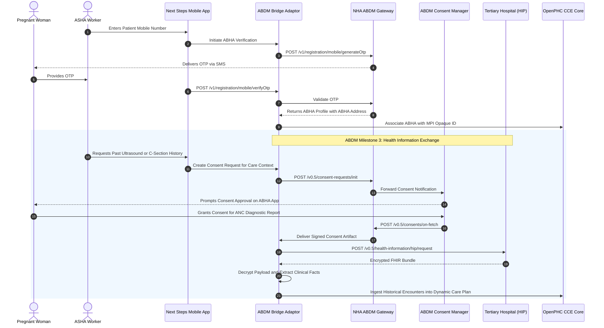
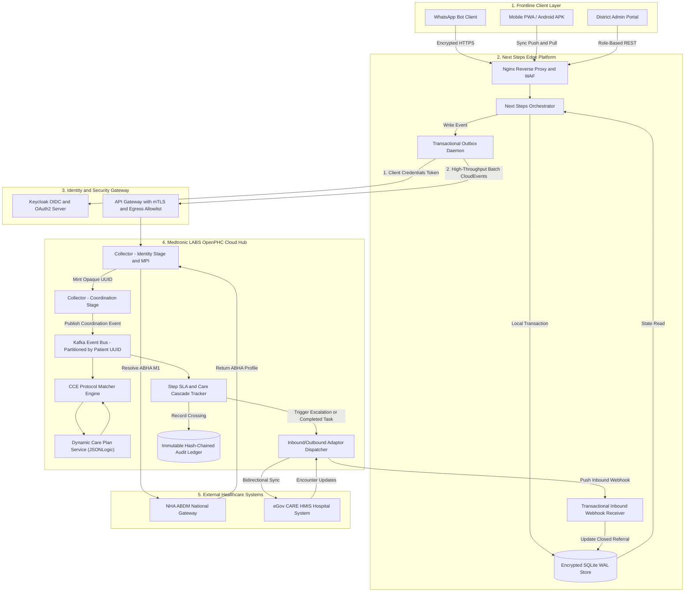

# Senior Principal Architecture Audit & Target Blueprint: OpenPHC V1.1 ↔ Next Steps Integration

**Document Version:** 2.0.0 (Enterprise Production Target)  
**Author:** Antigravity Senior Principal Systems, Healthcare & Security Architect  
**Authoritative References:**  
1. Medtronic LABS *OpenPHC Architecture Description V1.1* (`OpenPHC Architecture Description V1.1.docx`)  
2. Next Steps Integration Baseline & Transactional Outbox Audit (`CCE_ARCHITECTURE_AUDIT.md`)  
3. Government of India *Digital Personal Data Protection Act, 2023* (DPDP Act)  
4. National Health Authority (NHA) *Ayushman Bharat Digital Mission (ABDM) Architecture Specifications* (M1, M2, M3)  
5. Engineering Rigor & Lifecycle Frameworks (`addyosmani/agent-skills`)  
6. Zero-Trust Security Audit & Threat Modeling Framework (`cloudflare/security-audit-skill`)  

---

## 1. Executive Summary & Strategic Context

The convergence of the **Next Steps Frontline Platform** (WhatsApp conversational engine and offline-first mobile app) with the **Medtronic LABS Care Coordination Engine (CCE / OpenPHC)** represents a flagship digital public health deployment for maternal, newborn, and non-communicable disease (NCD) care in India (e.g., AIIMS Ballabgarh AI-CARE pilot).

While the existing Next Steps prototype successfully pioneered frontline adoption through zero-friction WhatsApp interactions and an offline SQLite transactional outbox, evaluating it against the formal **OpenPHC Architecture Description V1.1** reveals a significant architectural gap:
- **Next Steps** was engineered as an *edge clinical application* focusing on last-mile usability and push-based telemetry.
- **OpenPHC V1.1** is specified as a *national-scale, multi-tenant care coordination hub* governed by strict **ISO/IEC/IEEE 42010 arc42 modularity**, **four-zone data isolation**, **dynamic care-plan state machines**, **immutable audit ledgers**, and statutory compliance with India's **DPDP Act 2023** and **ABDM**.

This document delivers an exhaustive, senior-level architectural synthesis. It maps all **similarities**, exposes **12 structural and compliance gaps**, and defines the **Target Production Architecture** that renders Next Steps and OpenPHC fully compliant with Indian privacy laws, federated with the national health grid (ABHA/ABDM), and resilient against adversarial threats.

---

## 2. Deep Comparative Analysis: OpenPHC V1.1 vs. Current Next Steps

### 2.1 Core Architectural Similarities (Points of Alignment)

| Domain | OpenPHC V1.1 Specification | Current Next Steps Implementation | Architectural Verdict |
| :--- | :--- | :--- | :--- |
| **Edge Resilience** | Treats offline devices, late sync, and network dropouts as normal operational states. | Embedded SQLite running in WAL mode with an asynchronous outbox worker daemon (`outboxWorker.ts`). | **Aligned**: Both prioritize frontline worker autonomy without blocking on cloud WAN latency. |
| **Event Envelope** | Standardizes on **CloudEvents 1.0** envelopes with typed metadata (`specversion`, `type`, `source`, `subject`). | Dispatches CloudEvents 1.0 JSON payloads containing healthcare task metadata. | **Aligned**: Common messaging grammar established. |
| **Clinical Payload** | Uses HL7 FHIR R4 resources (`Task`, `ServiceRequest`, `Encounter`) for clinical state exchange. | Emits FHIR R4 `Task` resources with category codes (`ANC_VISIT`, `LAB`, `REFERRAL`). | **Aligned**: Shared FHIR foundation, though Next Steps currently uses an ad-hoc subset. |
| **Identity Management** | Keycloak OAuth2 / OpenID Connect with client credentials grant for machine-to-machine authentication. | `cceAuth.ts` requests Keycloak bearer tokens using `client_credentials` (`nextstep-emitter`) with token caching. | **Aligned**: Secure server-to-server auth baseline in place. |
| **Clinical Mission** | Closed-loop referral tracking from community (ASHA/ANM) through Subcentre, PHC, CHC, to District Hospital. | Multi-tier step tracking (`SUBCENTRE`, `PHC`, `CHC`, `DH`) with WhatsApp interactive buttons for referral closure. | **Aligned**: Unified clinical theory of change. |

---

### 2.2 Critical Gaps & Divergences Matrix

```
┌──────────────────────────────────────────────────────────────────────────────────────────────────┐
│                                 ARCHITECTURAL GAP HEATMAP                                       │
├──────────────────────────────────────┬───────────────────────────────────┬───────────────────────┤
│ Gap Category                         │ OpenPHC V1.1 Requirement          │ Current Next Steps    │
├──────────────────────────────────────┼───────────────────────────────────┼───────────────────────┤
│ 1. Data Zoning & DPDP Isolation      │ 4 Isolated Network Zones (P0)     │ Monolithic Co-mingled │
│ 2. Patient Pseudonymization          │ Opaque UUIDs Only behind Gate     │ Cleartext PII in Outbox│
│ 3. Ingestion Loop Directionality     │ Bidirectional Receiver Adaptor    │ Push-Only Unidirectional│
│ 4. Event Idempotency & Hashing       │ Deterministic Content Hashes      │ Randomized Date.now() │
│ 5. Care Plan State Management        │ Dynamic Versioned Plan Engine     │ Hardcoded SQLite Rows │
│ 6. Regulatory Consent Lifecycle      │ Multilingual Consent + Revocation │ Implicit Assumed Opt-In│
│ 7. Pediatric & Adolescent Controls   │ DPDP Sec 9 Guardian Verification  │ No Guardian Linking   │
│ 8. Auditability & Evidence Ledger    │ Append-Only Hash-Chained Ledger   │ Ephemeral SQLite Logs │
│ 9. National Grid Integration (ABDM)  │ Milestone 1, 2, 3 Gateway Adapter │ Local Database IDs    │
│ 10. Workforce & Registry Governance  │ Authoritative Registries (ADR 5)  │ Unfederated users tbl │
│ 11. Security & Network Transport     │ mTLS, KMS per Zone, RLS           │ Single Token, Flat DB │
│ 12. Batch Protocol Ingestion         │ High-throughput POST /batch (207) │ Sequential HTTP Loop  │
└──────────────────────────────────────┴───────────────────────────────────┴───────────────────────┘
```

#### Detailed Gap Deconstruction:

1. **Monolithic Data Storage vs. 4-Zone Privacy Architecture**:
   - *OpenPHC V1.1*: Mandates 4 logically and cryptographically isolated zones: **Identity Zone**, **Coordination Zone**, **Clinical Planning Zone**, and **Analytics Zone**. Services in the Coordination Zone *never* touch patient names, phones, or ABHA numbers.
   - *Current Next Steps*: Stores all PII, health tasks, user credentials, and outbox payloads co-mingled in a single SQLite database file (`data/nextsteps.db`) hosted on a single EC2 instance (`13.232.251.63`).
2. **PII Leakage in Event Envelopes**:
   - *OpenPHC V1.1*: The collector identity stage resolves the patient against a Master Patient Index (MPI) and replaces all identifiers with an opaque, unguessable UUID (`urn:uuid:...`).
   - *Current Next Steps*: The transformer passes local database IDs (`Patient/w1`, `Patient/pw_01`) and embeds plain-text human names in `Task.for.display` (`Sunita Devi`) and `Task.note` (`Closed by Priya`), leaking PII over the wire and into CCE queues.
3. **Absence of Bidirectional Receiver Adaptor**:
   - *OpenPHC V1.1*: Mandates a symmetric `Receiver` adaptor on edge platforms that subscribes to OpenPHC webhook dispatches, processing inbound clinical alerts, supervisor escalations, and hospital referral completions.
   - *Current Next Steps*: Entirely push-only. When a referred pregnant woman is admitted and treated at a CHC, the sub-centre ANM's WhatsApp bot never receives automated confirmation unless manual offline re-entry occurs.
4. **Non-Deterministic Event Identifiers**:
   - *OpenPHC V1.1*: Requires every event to carry a deterministic event UUID computed from entity state and content hash, ensuring strict de-duplication across network replays.
   - *Current Next Steps*: `cceTransformer.ts` computes `eventId` using `Date.now().toString(36)`. Re-evaluating or retrying an outbox row generates a brand new ID, bypassing CCE's deduplication cache and corrupting analytics.
5. **Static Task Lists vs. Immutable Versioned Care Plans**:
   - *OpenPHC V1.1*: Dynamic Care Plan Service creates versioned, immutable plans (Version 0 starter -> Version 1 clinical confirmation -> Version 2+ dynamic update). Older plans are never mutated in-place; they are superseded, withdrawn, or completed.
   - *Current Next Steps*: Hardcoded step categories (`ANC_VISIT`, `LAB`, `REFERRAL`) in SQLite with mutable in-place status flags (`OPEN` -> `DONE`).
6. **Absence of DPDP Consent & Crypto-Shredding Engine**:
   - *OpenPHC V1.1*: Section 7.10 specifies a full Privacy Control Plane with granular purpose tags, cryptographic consent tokens, retention clocks, and crypto-shredding keys per patient.
   - *Current Next Steps*: Assumes implicit consent; has no digital consent capture, no withdrawal mechanism, and retains patient data indefinitely in SQLite.

---

## 3. Statutory Compliance: India DPDP Act 2023 Architecture

The Digital Personal Data Protection Act, 2023 (DPDP Act) imposes stringent obligations on healthcare entities. In the OpenPHC/Next Steps deployment, the institutional roles are legally established as:
- **Data Fiduciary (Section 2(i))**: AIIMS (All India Institute of Medical Sciences) or the State Department of Health & Family Welfare. Holds legal accountability for purpose determination, lawful basis, and data principal rights.
- **Data Processor (Section 2(k))**: Medtronic LABS. Processes personal data strictly on behalf of and under contractual instructions from the Data Fiduciary.

```
┌─────────────────────────────────────────────────────────────────────────────────────────────────┐
│                           DPDP ACT 2023 STATUTORY COMPLIANCE BLUEPRINT                          │
├─────────────────────┬─────────────────────────────────┬─────────────────────────────────────────┤
│ DPDP Act Section    │ Legal Requirement               │ Architectural Implementation Mechanism  │
├─────────────────────┼─────────────────────────────────┼─────────────────────────────────────────┤
│ Section 5           │ Multilingual Notice Prior to    │ Interactive WhatsApp Notice & PWA Modal │
│                     │ Data Collection                 │ in Hindi/English before registration.   │
├─────────────────────┼─────────────────────────────────┼─────────────────────────────────────────┤
│ Section 6           │ Granular, Freely Given,         │ Consent Artifacts with cryptographic    │
│                     │ Revocable Consent               │ hash; withdrawal cascades across gates. │
├─────────────────────┼─────────────────────────────────┼─────────────────────────────────────────┤
│ Section 8(5)        │ Reasonable Security Safeguards  │ Zero-trust network zones, AES-256 GCM,  │
│                     │ against Breaches (₹250 Cr Fine) │ mTLS, role-based row-level security.    │
├─────────────────────┼─────────────────────────────────┼─────────────────────────────────────────┤
│ Section 8(7)        │ Purpose Fulfillment Erasure     │ Automated Retention Clock daemon and    │
│                     │ and Unlinking                   │ per-patient Crypto-Shredding in MPI.    │
├─────────────────────┼─────────────────────────────────┼─────────────────────────────────────────┤
│ Section 9           │ Verifiable Parental Consent for │ Mandatory Mother/Guardian linkage       │
│                     │ Children & Newborns             │ before newborn immunization tracking.   │
├─────────────────────┼─────────────────────────────────┼─────────────────────────────────────────┤
│ Section 11          │ Data Principal Right to Access, │ Self-service WhatsApp Bot Flow & Web    │
│                     │ Summary, Correction & Erasure   │ Portal to request records & audit trail.│
├─────────────────────┼─────────────────────────────────┼─────────────────────────────────────────┤
│ Section 16          │ Cross-Border Data Restrictions  │ Egress Gateway allowlist: 100% cloud    │
│                     │ & Domestic Processing           │ infrastructure & LLM in India regions.  │
└─────────────────────┴─────────────────────────────────┴─────────────────────────────────────────┘
```

### 3.1 The 4-Zone Privacy Isolation Architecture

To make DPDP compliance structural rather than procedural, data is segmented into four physically and cryptographically isolated network zones:

```mermaid
flowchart TB
    subgraph IdentityZone["1. Identity Zone - Isolated PII Subnet"]
        Beneficiary["Frontline Beneficiary - Citizen"]
        Worker["Frontline Worker - ASHA / ANM"]
        MPI["Master Patient Index - Opaque ID Mint"]
        ID_Collector["Collector - Identity Stage"]
        Consent_Svc["Consent Registry and Policy Engine"]
        SMS_Worker["SMS / WhatsApp Inbound-Outbound"]
    end

    subgraph CoordinationZone["2. Coordination Zone - Opaque IDs Only"]
        Coord_Collector["Collector - Coordination Stage"]
        Kafka_Bus["Enterprise Kafka Event Bus"]
        CCE_Engine["CCE Care Plan Engine and Matcher"]
        Step_SLA["Step SLA and Deviation Evaluator"]
        Action_Router["Action and Referral Dispatcher"]
    end

    subgraph ClinicalPlanningZone["3. Clinical Planning Zone - Clinical Knowledge"]
        Plan_Svc["Dynamic Care Plan Service"]
        Rule_Engine["Clinical Protocol and JSONLogic Engine"]
        Fact_Store["Confirmed Clinical Facts Store"]
    end

    subgraph AnalyticsZone["4. Analytics Zone - De-Identified"]
        Clickhouse["ClickHouse Aggregations"]
        Insights_API["CCE Insights - Anonymized Metrics"]
    end

    Beneficiary -->|1. Interactive Consent and Notice| Consent_Svc
    Worker -->|2. Register Patient with PII| ID_Collector
    ID_Collector -->|3. Resolve or Mint Opaque ID| MPI
    ID_Collector -->|4. Forward CloudEvent with Opaque UUID| Coord_Collector
    
    Coord_Collector -->|5. Validate Schema and Purpose Tag| Kafka_Bus
    Kafka_Bus --> CCE_Engine
    Kafka_Bus --> Step_SLA
    
    CCE_Engine -->|6. Query Plan Templates| Plan_Svc
    Plan_Svc -->|Return Plan Definitions| CCE_Engine
    Plan_Svc --> Rule_Engine
    Rule_Engine --> Plan_Svc
    Plan_Svc --> Fact_Store
    
    Step_SLA -->|7. Escalate Deviation| Action_Router
    Action_Router -->|8. Dispatch Action with Opaque ID| SMS_Worker
    SMS_Worker -->|9. Lookup Phone via MPI and Deliver| Worker

    Kafka_Bus -. 10. Strip IDs and Aggregate .-> Clickhouse
    Clickhouse --> Insights_API
```

#### Enforcement Principles:
1. **Zero-PII Coordination**: Services in Zone 2 receive CloudEvents where `subject: "urn:uuid:8f192b0c-..."`. Names, phone numbers, and physical addresses are physically absent from this subnet.
2. **Reverse Delivery Tokenization**: When CCE needs to notify an ASHA about an overdue visit, it dispatches a command containing the opaque patient ID and the recipient ASHA role. Only `SMS_Worker` (residing strictly in Zone 1) queries the MPI to resolve the recipient's phone number.
3. **Crypto-Shredding for Instant Erasure (Section 8(7))**: Each patient's PII in the MPI is encrypted with a dedicated Data Encryption Key (DEK). When a patient exercises their statutory Right to Erasure, deleting their DEK renders all historical audit logs, Kafka archives, and database snapshots instantly and irrevocably cryptographically unrecoverable (*Crypto-Shredded*).

---

## 4. Ayushman Bharat Digital Mission (ABDM) Compliance Architecture

To evolve Next Steps into an accredited national public health participant, the architecture incorporates the three milestones mandated by the National Health Authority (NHA):

```
┌─────────────────────────────────────────────────────────────────────────────────────────────────┐
│                                 ABDM MILESTONES 1, 2, 3 MATRIX                                  │
├───────────────┬───────────────────────────────────────┬─────────────────────────────────────────┤
│ ABDM Stage    │ Technical Specification               │ Next Steps & OpenPHC Component          │
├───────────────┼───────────────────────────────────────┼─────────────────────────────────────────┤
│ Milestone 1   │ ABHA Creation & Verification          │ ABHA Resolver Module in Identity Zone;  │
│ (M1)          │ (Aadhaar OTP / Mobile OTP / Bio)      │ Links ABHA ID & ABHA Address (@abdm).   │
├───────────────┼───────────────────────────────────────┼─────────────────────────────────────────┤
│ Milestone 2   │ Health Information Provider (HIP)     │ ABDM Bridge Service exposes on-discover,│
│ (M2)          │ Registration, Discovery & Care Context│ on-init, and on-confirm endpoints.      │
├───────────────┼───────────────────────────────────────┼─────────────────────────────────────────┤
│ Milestone 3   │ Health Information User (HIU) &       │ Consent Manager Gateway client fetches  │
│ (M3)          │ Consent Manager Gateway Integration   │ historical hospital encounters via NHA. │
└───────────────┴───────────────────────────────────────┴─────────────────────────────────────────┘
```



---

## 5. Security Architecture & Threat Model (Cloudflare Security Audit Harness)

Applying the structured 6-phase audit harness from the `cloudflare/security-audit-skill`, we analyze trust boundaries, hunting attack classes, and hardening controls:

```
┌─────────────────────────────────────────────────────────────────────────────────────────────────┐
│                                THREAT MODEL & DEFENSIVE MATRIX                                  │
├─────────────────────┬───────────────────────────────┬───────────────────────────────────────────┤
│ Attack Class        │ Specific Threat Scenario      │ Architectural Countermeasure              │
├─────────────────────┼───────────────────────────────┼───────────────────────────────────────────┤
│ Web Protocol & Auth │ Replay attacks on webhook or  │ Per-message nonces, strict 300s timestamp │
│                     │ token hijacking on WAN.       │ window, mutual TLS (mTLS) on all hops.    │
├─────────────────────┼───────────────────────────────┼───────────────────────────────────────────┤
│ Messaging Trust     │ SIM swap / recycled phone     │ Cryptographic worker PIN challenge and    │
│                     │ impersonating registered ASHA.│ biometric app auth; unconfirmed facts flag│
├─────────────────────┼───────────────────────────────┼───────────────────────────────────────────┤
│ AI / LLM Injection  │ Malicious doctor notes trick  │ LLM output restricted to JSON fact parsing;│
│                     │ LLM into issuing invalid plan.│ deterministic JSONLogic governs plan rules│
├─────────────────────┼───────────────────────────────┼───────────────────────────────────────────┤
│ Data at Rest        │ Unauthorized extraction of    │ SQLCipher (AES-256) at edge; AWS KMS per  │
│                     │ unencrypted SQLite database.  │ zone; PostgreSQL Transparent Encryption.  │
├─────────────────────┼───────────────────────────────┼───────────────────────────────────────────┤
│ Cloud & Ingress     │ DDoS or credential stuffing on│ Cloudflare WAF / Nginx rate limiting;     │
│                     │ Keycloak / CCE APIs.          │ circuit breaker pattern in outbox clients.│
├─────────────────────┼───────────────────────────────┼───────────────────────────────────────────┤
│ Supply Chain        │ Compromised upstream npm /    │ Automated SBOM generation, container image│
│                     │ Python package dependency.    │ signing (Cosign), strict lockfile freeze. │
└─────────────────────┴───────────────────────────────┴───────────────────────────────────────────┘
```

### 5.1 Trust Boundary Hardening
1. **Network mTLS**: All traffic between Next Steps Backend, Edge Gateway, Identity Collector, CCE Core, and Keycloak enforces **TLS 1.3 with Mutual Client Certificate Authentication (mTLS)**.
2. **Circuit Breaker Pattern**:
   - `cceAuth.ts` and `outboxWorker.ts` implement an automated 3-state circuit breaker (`CLOSED`, `OPEN`, `HALF-OPEN`).
   - If Keycloak or the CCE API fails 3 consecutive times, the breaker trips for 60 seconds, preventing connection starvation and cascading socket exhaustion on production servers.
3. **Deterministic Event Hasher (Zero-Duplication)**:
   - Event IDs are generated deterministically:
     $$\text{EventID} = \text{SHA256}(\text{StepID} \parallel \text{Status} \parallel \text{ClinicalTimestamp})[0:16]$$
   - Guaranteed identical ID across retries ensures CCE deduplicator cleanly drops retransmissions without inflating metrics.

---

## 6. Target Production Architecture: Closed-Loop Enterprise Integration

The following blueprint defines the target architecture uniting the Next Steps Frontline Edge with the full OpenPHC Care Coordination Engine:



---

## 7. Actionable Engineering & Regulatory Roadmap (P0 - P3)

Following the lifecycle discipline from `addyosmani/agent-skills` (Define -> Plan -> Build -> Verify -> Review -> Ship):

```
┌─────────────────────────────────────────────────────────────────────────────────────────────────┐
│                              PRIORITIZED IMPLEMENTATION ROADMAP                                 │
├──────────┬───────┬──────────────────────────────────────────┬──────────┬────────────────────────┤
│ Priority │ Track │ Deliverable & Quality Gate               │ Duration │ Risk Mitigated         │
├──────────┼───────┼──────────────────────────────────────────┼──────────┼────────────────────────┤
│ **P0**   │ Edge  │ **Deterministic Event Hashing**: Replace │ 2 days   │ Upstream duplicate     │
│ (Week 1) │       │ Date.now() with SHA-256 state hashing.   │          │ event inflation in CCE.│
├──────────┼───────┼──────────────────────────────────────────┼──────────┼────────────────────────┤
│ **P0**   │ Edge  │ **Circuit Breaker on Keycloak / CCE**:   │ 3 days   │ Production socket      │
│ (Week 1) │       │ Implement 3-state breaker in cceAuth.ts. │          │ exhaustion on outage.  │
├──────────┼───────┼──────────────────────────────────────────┼──────────┼────────────────────────┤
│ **P1**   │ DPDP  │ **Multilingual WhatsApp Consent Flow**:  │ 1 week   │ DPDP Section 5 & 6     │
│ (Week 2) │       │ Explicit opt-in notice in Hindi/English. │          │ statutory compliance.  │
├──────────┼───────┼──────────────────────────────────────────┼──────────┼────────────────────────┤
│ **P1**   │ Hub   │ **Batch Collector Endpoint (/v1/batch)**:│ 2 weeks  │ 90% network overhead   │
│ (W 2-3)  │       │ Implement multi-event ingestion in CCE.  │          │ reduction during sync. │
├──────────┼───────┼──────────────────────────────────────────┼──────────┼────────────────────────┤
│ **P1**   │ Both  │ **Bidirectional Receiver Webhook**:      │ 2 weeks  │ Closed-loop referral   │
│ (W 3-4)  │       │ Inbound receiver in Next Steps backend.  │          │ failure across tiers.  │
├──────────┼───────┼──────────────────────────────────────────┼──────────┼────────────────────────┤
│ **P2**   │ ABDM  │ **ABDM Milestone 1 (ABHA Verification)**:│ 3 weeks  │ National patient ID    │
│ (Month 2)│       │ Integrate Aadhaar/Mobile OTP in app.     │          │ fragmentation.         │
├──────────┼───────┼──────────────────────────────────────────┼──────────┼────────────────────────┤
│ **P2**   │ DPDP  │ **MPI Pseudonymization & Crypto-Shred**: │ 3 weeks  │ Cleartext PII exposure │
│ (Month 2)│       │ Strip PII before entering CCE queues.    │          │ across backend queues. │
├──────────┼───────┼──────────────────────────────────────────┼──────────┼────────────────────────┤
│ **P3**   │ ABDM  │ **ABDM Milestone 2 & 3 (HIP / HIU)**:    │ 4 weeks  │ Inter-hospital records │
│ (Month 3)│       │ Consent Manager & health data exchange.  │          │ access & continuity.   │
└──────────┴───────┴──────────────────────────────────────────┴──────────┴────────────────────────┘
```

---

## 8. Conclusion & Architectural Verdict

The integration between Next Steps and OpenPHC possesses an exceptionally strong foundation: a field-tested frontline interface paired with an enterprise clinical engine.

By transitioning from the current prototype topology to the **Target 4-Zone Privacy Architecture**, implementing **deterministic event hashing**, activating the **symmetric inbound receiver adaptor**, and establishing **ABDM M1-M3 compliance**, the joint system will achieve:
1. **Full Statutory Compliance with India's DPDP Act, 2023**, safeguarding patient data with zero-PII coordination and cryptographic unlinking.
2. **National Interoperability via ABDM**, allowing longitudinal maternal care journeys to federate across state and private health systems.
3. **Enterprise Reliability**, ensuring frontline health workers never lose data, duplicate events, or experience system lockouts during field clinics.
